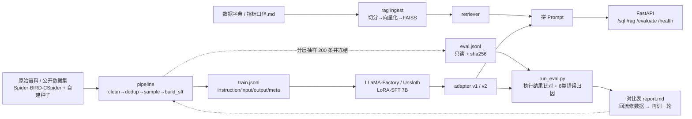

# 数据开发助手 —— 基于 LoRA-SFT + RAG 的 Text-to-SQL 与指标口径问答系统

> 求职作品集项目，目标岗位：**大模型训练工程师（post-training / SFT）**。
> 项目定位：把现成 7B 开源基座**调成能干特定活**，不是造模型。
> 进度基准以 [`PLAN.md`](PLAN.md) 为准；本仓库是它的代码实现。

## 一句话概述

用数据开发的老本行（清洗 / 去重 / 质检 / 分层采样）构建高质量 Text-to-SQL 指令集，
对 7B 开源基座做 LoRA-SFT；用**冻结的独立评测集 + SQL 执行结果比对**做自动评测，
以「前后对比表」证明数据工作有效；企业私有的表结构与指标口径交给轻量 RAG；
最后用 FastAPI 服务化，Docker 一键复现。

## 架构



**分工**：LoRA 学「按口径输出 SQL 的行为与格式」；私有表结构 / 指标定义走 RAG 在推理时补进 Prompt。
两者不混：不把公司口径塞进微调语料。

## 快速开始（CPU 即可跑通全流程）

```bash
# 0. 环境
python -m venv .venv && source .venv/bin/activate   # Windows: .venv\Scripts\activate
pip install -r requirements.txt

# 1. 构建 SQLite 数仓测试库（确定性种子，182 天 / 4639 订单）
python scripts/init_db.py

# 2. 数据流水线
python pipeline/clean.py          # 清洗 + 质检报告
python pipeline/dedup.py          # 精确 + MinHash 近似去重
python pipeline/sample.py --target 1200   # 难度分层 + 多样性均衡
python pipeline/build_sft.py --eval-size 200  # 生成训练集并冻结评测集

# 3. 评测管道自检（用 gold SQL 冒充模型输出，验证脚本本身）
python eval/run_eval.py --name smoke --generator debug_gold

# 4. 轻量 RAG 索引（未装可选依赖时自动降级到纯 Python TF-IDF）
python rag/ingest.py

# 5. 服务化
uvicorn serving.app:app --port 8000
# 或： docker compose -f serving/docker-compose.yml up --build

# 6. 一键自检
python scripts/smoke_test.py
```

更快：`make init pipeline smoke`（见 `Makefile`）。

### 接入大模型（让 /sql、/rag 真的出结果）

复制 `.env.example` 为 `.env`，**只填一个变量**即可接 DeepSeek：

```bash
DEEPSEEK_API_KEY=sk-你的key
```

程序导入 `common.*` 时会自动读 `.env`（`common/env.py`），检测到该 key 会自动使用
`https://api.deepseek.com/v1` 与 `deepseek-chat`。`.env` 已在 `.gitignore` 中，不会提交。

接任意 OpenAI 兼容服务（本地 vLLM / 其他云端）则填三个变量：
`LLM_API_BASE` / `LLM_API_KEY` / `LLM_MODEL`。
**优先级：终端 `export` 的环境变量 > `.env`**，方便临时换模型测试，不用改文件。

## 面向用户的工作台

打开 **`http://127.0.0.1:8000/`** 即是图形化工作台（原生 HTML/CSS/JS，无构建、无 Node 依赖），
四个视图：

| 视图 | 内容 |
|---|---|
| SQL 工作台 | 自然语言提问、示例问题一键填入、生成 SQL 代码、在测试库执行并展示带列名的结果表 |
| 指标口径问答 | RAG 问答，展示答案与 `[1][2]` 引用来源卡片 |
| 评测报告 | 指标卡片 + 前后对比表 + `report.md` 原文（自检结果会标注「非正式」） |
| 系统状态 | 各依赖就绪状态、系统链路、接口清单 |

面向开发者的 Swagger 仍在 **`http://127.0.0.1:8000/docs`**。

## 四个端点

| 端点 | 作用 |
|---|---|
| `GET /` | 工作台首页 |
| `GET /health` | 测试库 / 冻结评测集 / RAG 索引 / 模型名就绪状态 |
| `POST /sql` | Text-to-SQL；`execute=true` 时在测试库执行并返回 `rows` + `columns`（仅本地调试） |
| `POST /rag` | 检索数据字典 → 拼进 Prompt → 模型生成带 `[1][2]` 引用的口径回答 |
| `GET /evaluate` | 返回各组评测指标与 `report.md` 对比表 |

```bash
curl -s http://127.0.0.1:8000/health
curl -s -X POST http://127.0.0.1:8000/sql \
  -H 'Content-Type: application/json' \
  -d '{"question":"统计 2024-03 的 GMV","execute":true}'
```

## 目录结构

```
llm-portfolio/
├── PLAN.md                     进度基准（唯一，代码不改动它）
├── data/
│   ├── raw/                    种子样本 + 公开数据集 license 记录
│   ├── processed/              清洗/去重/采样中间产物 + 质检报告
│   ├── warehouse_schema.sql    数仓 DDL（同时作为 Prompt 里的表结构）
│   ├── train.jsonl / eval.jsonl / eval.jsonl.sha256
│   └── SCHEMA.md               instruction/input/output/meta 定义
├── common/                     路径 / IO / SQL 归一化 / SFT schema / 生成器接口
├── pipeline/                   clean → dedup → sample → build_sft + quality_rules
├── train/                      lora_config.yaml / dataset_info.json / train.py / merge.py
├── eval/                       run_eval.py / error_taxonomy.py / report.md / results/
├── rag/                        ingest.py / retriever.py / docs/数据字典.md / index/
├── serving/                    app.py / schemas.py / web/(工作台) / Dockerfile / compose
├── scripts/                    init_db.py / smoke_test.py
└── tests/                      pytest 单测
```

## 关键设计（面试讲点）

1. **评测集冻结 + 双重泄漏校验**：`eval.jsonl` 按 `level × theme × sql_template` 分层抽出，
   与训练集做「归一化哈希精确重复 + MinHash Jaccard 近似重复」校验；写入 `sha256` 后
   `build_sft.py` 拒绝覆盖，`run_eval.py` 每次校验和比对，改动即报错——**所有对比数字才有意义**。
2. **硬指标不靠人工打分**：生成 SQL 与 gold SQL 在同一 SQLite 库执行，比对结果集
   （无序多重集、浮点容差），产出 `result_accuracy / execution_success / exact_match`。
   这正是 PLAN 里「不做大模型测评师」的边界。
3. **6 类错误归因回流数据**：`EXEC_ERROR / SCHEMA_ERROR / TIME_SCOPE_ERROR /
   JOIN_AGG_ERROR / DEDUP_ERROR / OTHER_RESULT_ERROR`，哪类占比高就补哪类样本再训一轮。
4. **Prompt 三处统一**：训练、评测、线上都由 `common/schema.py::build_input()` 构造，
   避免最隐蔽的掉分原因。
5. **SFT 只对 answer 算 loss**：`train_on_prompt: false`，instruction/input 被 mask。
6. **质检带严重级别**：8 条规则（可执行性、占位符、分区裁剪、问题-SQL 结构一致性…），
   error 丢弃 / warn 标记，产出可归档报告，对应 JD「能发现数据错误、不一致及潜在偏差」。
7. **可选依赖降级**：没装 sentence-transformers/FAISS 也能跑通 RAG 全链路
   （字符 n-gram TF-IDF + numpy 余弦），装了自动切语义向量。

## 训练与对比实验（需 GPU，PLAN 1 月节点）

```bash
pip install -r requirements-train.txt
# LLaMA-Factory 需按官方仓库单独安装
python train/train.py --dry-run --name v1            # 先检查配置
python train/train.py --name v1                     # r=16 / 3 epoch / lr 1e-4
python train/train.py --name v3 --rank 8
python train/train.py --name v4 --epochs 2 --lr 5e-5
python train/merge.py --adapter outputs/lora-v1     # 合并后可上 vLLM
```

评测（三组必须指向**同一个冻结评测集**）：

```bash
python eval/run_eval.py --name base --generator api   --model base-model
python eval/run_eval.py --name v1   --generator vllm --model lora-v1
python eval/run_eval.py --name v3   --generator vllm --model lora-v3
python eval/run_eval.py --compare     # → eval/report.md 对比表 + 简历 3 个数字
```

详细实验矩阵见 `train/experiments.md`。

## 前后对比表（占位，跑完自动覆盖）

| 实验 | 结果准确率 | 可执行率 | 精确匹配 | 相对基座 |
|---|---:|---:|---:|---:|
| base | — | — | — | — |
| v1 | — | — | — | — |
| v3 | — | — | — | — |

> 这三行是项目**唯一不可替代的产出**（PLAN 2/5 节点）。简历的 3 个数字由
> `run_eval.py --compare` 自动生成，不要手写。

## 当前代码状态 vs PLAN 时间表

代码骨架已全部就位并可跑通。已完成 / 未完成如下（2026-11-07 更新）：

- [x] 自建扩充语料 274 条（`scripts/gen_samples.py`）
- [x] 组合式扩充语料 1,400 条（`scripts/expand_samples.py`，生成阶段按去重规则预筛）
- [x] 20 条示范业务 SQL（`data/raw/real_samples.jsonl`，`source=sample`，待核对口径后改 `real`）
- [x] **训练集 1,038 条 + 评测集 200 条已冻结**（`--eval-size 200` 生效）
- [x] 服务化 / RAG（2 月任务提前完成，按降级规则不再加功能）
- [ ] 把示范样本核对/替换为**你自己数仓的真实样本**（采集清单见 `data/raw/DATASETS.md`）
- [ ] 下载公开数据集并记录 license（schema 不匹配需改写 SQL，优先级低）
- [ ] 租单卡跑通 3 组 LoRA 实验，产出 `report.md` 对比表

> 2026-11-07 流水线实测：raw 1,744 条 → 清洗 1,744 → 双重去重 1,613 → 分层采样 1,250 →
> **训练集 1,038 条 + 评测集 200 条**（sha256 冻结，泄漏校验移除 12 条）。
> smoke 9/9、pytest 14 passed、`train.py --dry-run` 配置检查通过。
>
> **重要**：1,744 条里绝大多数是 self-authored 合成语料，不是真实业务数据。
> 按 PLAN 混入你自己的真实样本后仍需 `--force` 重建，重建后此前所有对比数字作废。
> `eval/report.md` 仍是占位，正式对比数字必须来自 1 月的 GPU 实验，不得手写。

## 边界（PLAN 第 3/4 节）

- 评测只做最小自动化版本：不做人工打分、rubric、LLM-as-judge、不设评测岗位。
- 不做预训练 / 造基座；项目定位是 post-training。
- RAG 最低优先级，时间不够可整体砍掉，不影响主攻岗位 #4。
- Transformer 只到概念层，不推公式、不手写实现。

## 常见问题

| 现象 | 处理 |
|---|---|
| `评测集校验和不匹配` | 评测集被改动，人工核查后决定是否 `--force` 重建（此前数字作废） |
| `/rag` 返回 `LLM 未就绪` | 正常：RAG 必须由模型生成答案，响应里附了拼好的 Prompt 供排查 |
| 检索结果不理想 | `pip install -r requirements-rag.txt` 后重跑 `rag/ingest.py`，自动切语义向量 |
| Windows 控制台 GBK 报错 | 脚本输出只用中文/ASCII，不含 emoji；如遇编码问题设 `PYTHONIOENCODING=utf-8` |
| 训练显存不够 | `--backend unsloth`（4bit）或换更小基座，见 PLAN 降级规则 |

## 复现性

`scripts/init_db.py` 用固定随机种子，所有评测结果可重复；
每次评测结果含 `eval_sha256` 与超参快照 `outputs/<name>/experiment.json`，
保证「分数与参数对得上」。
